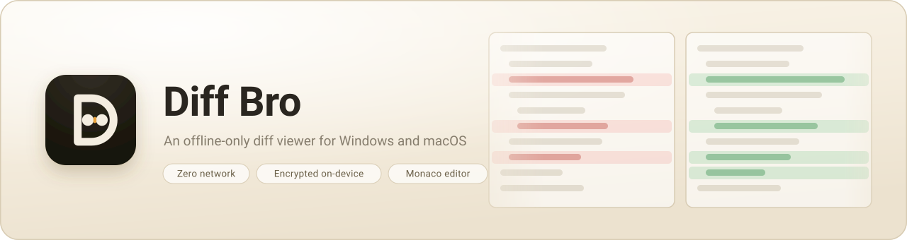
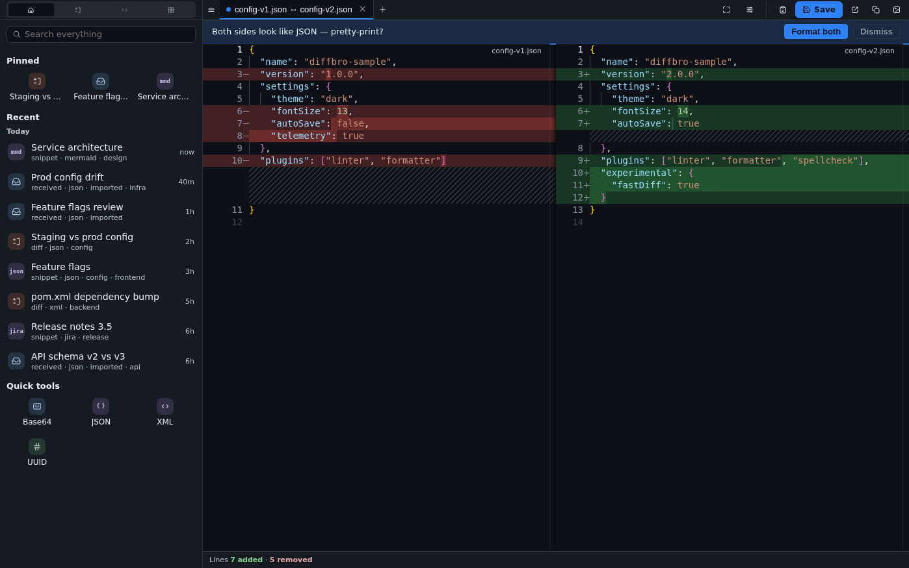
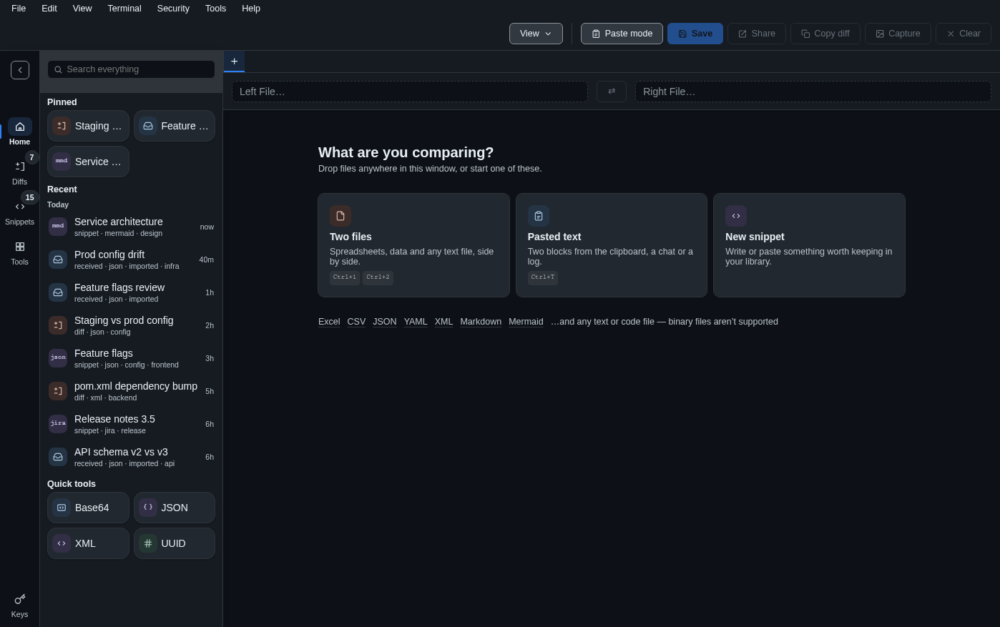
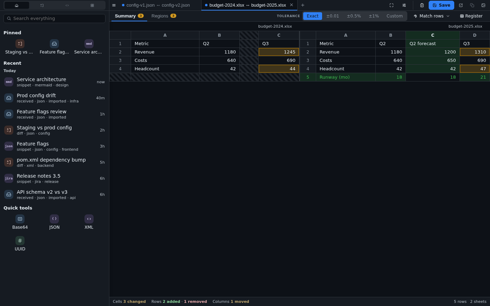
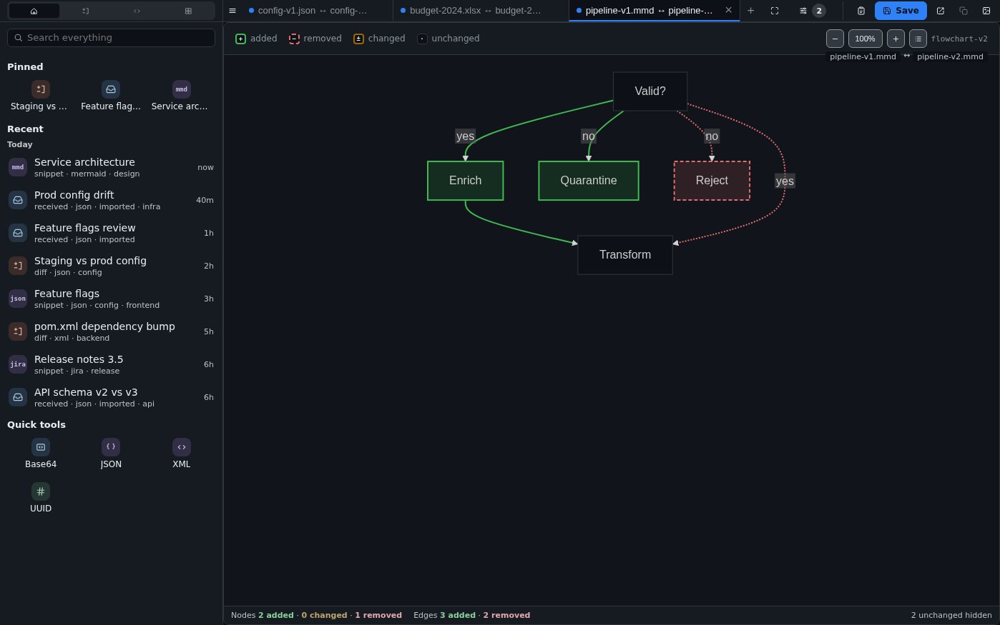
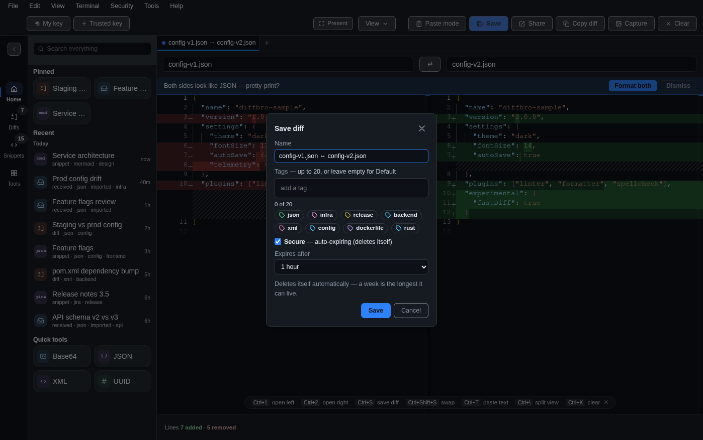

<p align="center">
  <picture>
    <source media="(prefers-color-scheme: dark)" srcset="docs/brand/hero-dark.svg">
    
  </picture>
</p>

<p align="center">
  <b>Stop pasting production configs into an online diff tool.</b><br>
  Compare two files, keep the ones worth keeping, and hand one to a teammate
  sealed —<br>with no account, no telemetry and not one network request.
</p>

<p align="center">
  
</p>

## Install

| OS                            | Get it                                                                                             |
| ----------------------------- | -------------------------------------------------------------------------------------------------- |
| **Windows** 10/11             | [`diff-bro-Setup-v<version>.exe`](https://github.com/mindaugaskasp/diff-bro/releases/latest)       |
| **macOS** 12+ (Apple silicon) | [`diff-bro-v<version>.dmg`](https://github.com/mindaugaskasp/diff-bro/releases/latest) or Homebrew |
| **Linux** (Ubuntu/Debian)     | [`diff-bro-v<version>.deb`](https://github.com/mindaugaskasp/diff-bro/releases/latest) or AppImage |

```bash
brew tap mindaugaskasp/tap && brew install --cask diff-bro
```

Builds are not yet signed, so Windows and macOS warn the first time you open the
app — see [packaging](docs/packaging.md).

## What it does

|                      |                                                                                                                       |
| -------------------- | --------------------------------------------------------------------------------------------------------------------- |
| **Compare**          | Two files or two pasted texts side by side, with every change highlighted.                                            |
| **Understands data** | Spreadsheets, JSON, YAML, XML and diagrams compare by meaning, not just by line.                                      |
| **Keep**             | Save comparisons and text snippets in a private, encrypted library.                                                   |
| **Share safely**     | Send a sealed file only the people you chose can open, and it expires on its own.                                     |
| **Tools**            | Format JSON, decode a token, convert a timestamp and more, without a website.                                         |
| **Make it yours**    | A System theme that follows your OS, twenty more, nested tags, and a quick search that finds anything in a keystroke. |

Everything in detail: [features](docs/features.md).

## Private by design

- **Nothing leaves your computer.** The app makes no network requests at all.
- **Encrypted at rest.** Saved work is locked with a key your operating system keeps.
- **Shared only with who you pick.** Details in the [security model](docs/security.md).

## A look around

<table>
  <tr>
    <td width="50%"></td>
    <td width="50%"></td>
  </tr>
  <tr>
    <td width="50%"></td>
    <td width="50%"></td>
  </tr>
</table>

## Build from source

Needs **Node 22.12+**.

```bash
npm install
npm run dev      # run it
npm run check    # lint + tests
```

No local Node? Run it in Docker instead — see [docker/README.md](docker/README.md).

## Docs

- [Features](docs/features.md) — everything the app does
- [Security model](docs/security.md) — the offline guarantee, sharing and keys
- [Architecture](docs/architecture.md) and [IPC & security](docs/ipc-security.md)
- [Packaging](docs/packaging.md), [Standards](docs/standards.md), [Glossary](docs/glossary.md)

## License

[Mozilla Public License 2.0](LICENSE) — use it commercially; changes to Diff Bro's
own files stay open.
